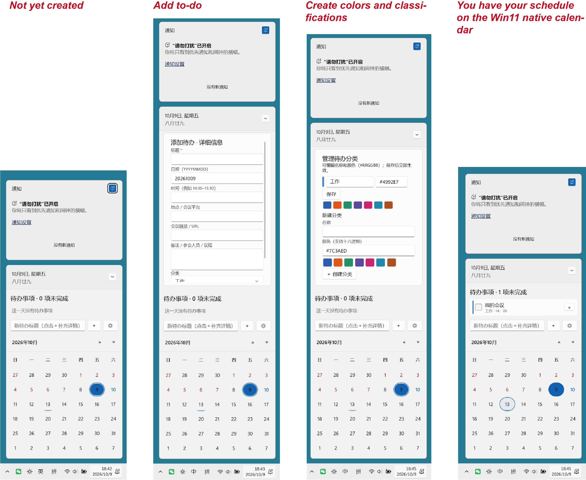

# Native Calendar Todo for Windows 11

在 **Windows 11 原生日历 / 通知中心弹窗**中加入可编辑待办，并标记中国法定节假日与调休工作日。项目基于 Windhawk，不替换系统日历界面。

> 当前版本：`v0.4.9`。这是公开整理后的源码快照；此前迭代已在 Windows 11 上实际使用，但当前公开版本仍建议在自己的 Windows/Windhawk 环境中重新编译验证。Windows 更新可能改变 Shell/XAML 结构并影响兼容性。



## 功能

- 按日期创建、编辑、完成和删除待办
- 支持时间、地点、会议链接、备注、自定义分类与颜色
- 在日期格中显示待办密度提示
- 通过 [CN-Holidays](https://github.com/cfap/CN-Holidays) 标记中国法定节假日和调休工作日
  - 节假日：`#B42336`
  - 调休工作日：`#0070C0`
- 待办保存在 Windhawk 本机存储中
- 提供标准 `SKILL.md`，可让本地 AI Agent 查询和修改同一份待办

当前不包含：农历/传统节日/节气、云同步、跨设备同步、独立桌面程序，以及 Agent 侧提醒推送。

## 给 AI Agent：安装这个 Skill

真正需要安装到 Agent 的目录是：

```text
https://github.com/hokie123/native-calendar-todo/tree/main/skills/native-calendar-todo
```

可以直接把下面这句话发给支持 Agent Skills / `SKILL.md` 的本地 Agent：

> 安装这个 Skill：https://github.com/hokie123/native-calendar-todo/tree/main/skills/native-calendar-todo 。先检查 Skill 内容和所需权限；如需执行本地脚本或写入 Windhawk 本地存储，请向我请求授权。安装后运行 `doctor` 验证，不要在验证失败时声称安装可用。

### 不同宿主

- **Codex**：如果宿主支持从 GitHub 路径安装 Agent Skill，可直接安装上面的目录；否则下载该目录后导入到本地 skills 目录。
- **WorkBuddy**：可导入本地 Skill 包；是否自动安装取决于安全扫描、自动安装设置和权限策略，高风险项仍应由用户确认。
- **CodeBuddy / 兼容 Agent Skills 的 IDE Agent**：可把该目录放入宿主支持的用户级或项目级 skills 目录。
- **豆包及其他 Agent**：是否能“直接安装”取决于具体客户端是否支持 Agent Skills / `SKILL.md` 以及本地脚本执行权限；本仓库不宣称所有版本均原生支持。

仓库根目录的 [`AGENTS.md`](AGENTS.md) 还提供了给 AI Agent 读取的安装规则。

> **注意：** 安装 Skill 只是在 Agent 中增加“操作 Native Calendar Todo”的能力，并不会自动安装 Windhawk 或日历 mod。本机必须先存在并启用 Native Calendar Todo mod。若未来希望做到“Agent 连 Windhawk mod 也一起自动部署”，需要再增加独立的安装器/部署流程。

## 安装 Windhawk mod

1. 安装 [Windhawk](https://windhawk.net/)。
2. 在 Windhawk 中选择 **Create a new mod**；若看不到该入口，请启用开发者模式。
3. 打开 [`native-calendar-todo.wh.cpp`](native-calendar-todo.wh.cpp)，复制完整源码到 Windhawk mod 编辑器。
4. 点击 **Compile Mod** 或按 `Ctrl+B`，编译成功后启用。
5. 按 `Win+N` 或点击任务栏时钟打开日历。

升级已有版本时，建议先备份当前源码，并在同一个 mod 中替换代码，不要重复安装第二份。项目保持 mod ID `win11-native-todo-calendar`，以兼容已有待办数据。

**兼容性：** 面向 x64 Windows 11 的 `ShellExperienceHost.exe` / `ShellHost.exe`。这是非官方 Windows Shell 定制，不属于 Microsoft 或 Windhawk 官方产品。

## AI Agent 如何操作待办

Skill 内置 [`calctl.py`](skills/native-calendar-todo/scripts/calctl.py)，仅使用 Python 标准库，直接读写 Windhawk 的 `todo-tasks-v2` 本地存储，不依赖额外 companion service、SQLite 数据库或命名管道。

```powershell
python skills\native-calendar-todo\scripts\calctl.py doctor --json
python skills\native-calendar-todo\scripts\calctl.py list --json
python skills\native-calendar-todo\scripts\calctl.py add --title "给老师回邮件" --day 20261115 --time 09:30 --json
```

详细行为规则见 [`skills/native-calendar-todo/SKILL.md`](skills/native-calendar-todo/SKILL.md)，存储格式见 [`skills/native-calendar-todo/references/storage-format.md`](skills/native-calendar-todo/references/storage-format.md)。

## 数据与隐私

待办内容保存在本机 Windhawk 存储中。Skill 正常使用时无需把待办上传到云端。Agent 写操作可能需要访问 `HKLM\SOFTWARE\Windhawk\Engine\ModsWritable\...\LocalStorage`；是否需要额外授权或提升权限由宿主环境决定。

请不要把个人待办、会议链接、凭据、私有 `.ics`、数据库或本机备份提交到仓库。

## 已知限制

- Windows 功能更新可能改变 Shell/XAML 结构，需要调整 Hook。
- 节假日 ICS 来自第三方来源，Shell 重启后首次加载可能需要网络。
- Windhawk Portable 的本地存储位置可能不同，当前 Agent Skill 不保证兼容。
- Agent 写入后，如弹窗没有立刻刷新，可关闭并重新打开 `Win+N`。

## 开发与贡献

修改 `native-calendar-todo.wh.cpp` 后，请在 Windhawk 中重新编译并至少验证：待办新增/编辑/删除、日期选择、分类颜色、节假日/调休颜色、深浅色主题和 Shell 重启后的行为。

提交可复现问题时，请附 Windows build、Windhawk 版本、复现步骤、预期/实际结果和经过脱敏的日志。

## 来源与许可证

本项目基于 `lonfro` 的 **[Agenda in Calendar View](https://windhawk.net/mods/agenda-in-calendar-view)**，其中 Shell hooking 工作亦保留对 `m417z` 的原始署名。仓库继续保留上游版权声明，并按 **GNU GPL v3** 发布，详见 [`LICENSE`](LICENSE)。
